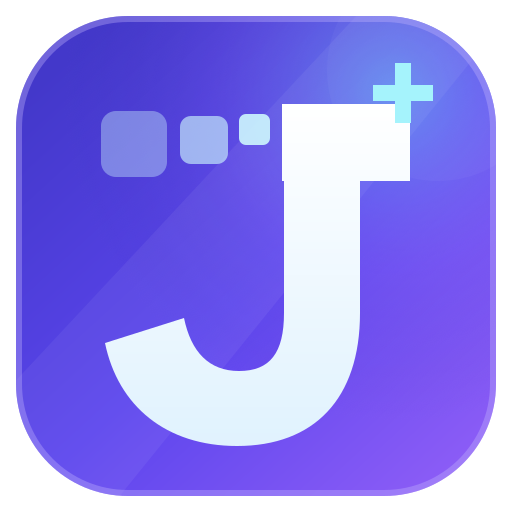

> **有料モデルの正規ライセンスコードを入手できるのは、[Buy Me a Coffee](https://buymeacoffee.com/kruk2) と [Unifans](https://app.unifans.io/c/kruk2) だけです。**

[English](README.md) | [**日本語**](README.ja.md) | [中文](README.zh.md)

#  Jasna 

Jasna は動画と画像のモザイクを復元します。シンプルな GUI と
コマンドラインがあり、すべて GPU で動きます（NVIDIA、または実験的に AMD）。

Jasna は無料です。支援者には、このプロジェクト用に訓練された追加モデルを使う
ためのライセンスコードが届きます: **unet-4x** アップスケーラーと、実験的な
**SD 1.5** 画像モデル（15 USD）、またはこの 2 つに **LTX** 復元モデルを加えたもの（25 USD）です。
[プロジェクトを支援する](#プロジェクトを支援する)をご覧ください。


## 目次

- [Jasna でできること](#jasna-でできること)
- [コミュニティ](#コミュニティ)
- [要件](#要件)
- [クイックスタート](#クイックスタート)
- [初回実行](#初回実行)
- [さらに詳しく](#さらに詳しく)
- [ベンチマーク](#ベンチマーク)
- [ライセンス](#ライセンス)
- [プロジェクトを支援する](#プロジェクトを支援する)
- [謝辞](#謝辞)
- [TODO](#todo)

## Jasna でできること

- 動画のモザイクを復元します。SD 1.5 モデルで画像のモザイクも復元します。
- 高速な `rfdetr-v6` モデルでモザイクを見つけます。他の検出モデルも使えます
  （大きい RF-DETR、Lada YOLO、ZeLeFans）。
- 2 つの復元モデル: 高速な **BasicVSR++**（既定、無料）と、遅いけれどより
  精細な [LTX](docs/ja/models.md#復元モデル)（有料、NVIDIA のみ）。
- オプションの[セカンダリ復元](docs/ja/models.md#セカンダリ復元)で、復元した
  部分がよりシャープになります。主に大きなモザイクと 4K で効きます（NVIDIA
  のみ）: **unet-4x**、**RTX Super Resolution**、**Topaz Video AI**。
- VR180 サイドバイサイド動画を左右の目ごとに処理し、設定はスタジオごとに
  選ばれます。
- **区間エディター**: 動画の一部だけを復元したり、モザイクをスキャンしたり、
  結果をプレビューしたり、範囲ごとにモデルを選んだりできます。
- クリップの境界をなめらかにし（オーバーラップとクロスフェード）、シーンの
  切り替わりをまたいで映像を混ぜません。
- **動画プレーヤー**: ファイルを作らずに、復元しながら動画を見られます。
- ブラウザーや、Jasna 用の [Stash](docs/ja/streaming.md#stash) へのストリーミング。

## コミュニティ

SLS Discord では、復元例、サポート、設定に
ついて話せます。あまり変な振る舞いはしないでください。

## 要件

- NVIDIA の **GTX 16 シリーズ / RTX 20 シリーズ以降**。GTX 10 シリーズ以前
  （GTX 1050/1060/1070/1080）では動きません。分からない場合: NVIDIA の
  [GPU 一覧](https://developer.nvidia.com/cuda/gpus)でコンピュート能力が
  7.5 以上である必要があります。
- NVIDIA ドライバーは Windows で **610 以上**、Linux で **580 以上**。
- AMD（実験的）: ROCm 対応 GPU（Radeon RX 7000/9000、Radeon 780M/760M/740M、
  Ryzen AI）。Windows では AMD Adrenalin ドライバー 26.8.1 以降。
- Jasna は、パスに英語の文字と数字だけを含むフォルダーに、ローカルディスク上で
  インストールしてください: Windows では NTFS、Linux では ext4、Btrfs、XFS。
- LTX にはさらに必要なものがあります。
  [LTX に必要なもの](docs/ja/models.md#ltx-に必要なもの)をご覧ください。

## クイックスタート

1. お使いのシステムと GPU に合うリリースをダウンロードします。
2. パスに英語の文字だけを含むフォルダーへ展開します。
3. アプリを起動します:
   - Windows: `jasna.exe` をダブルクリックします。
   - Linux NVIDIA: `jasna` ファイルを実行します。
   - Linux AMD: `run_jasna_amd.sh` を実行します。
4. 動画または画像を追加し、設定を選んで開始を押します。

初回起動には時間がかかります。メイン画面を開く前に、起動ウィンドウで
インストールの確認状況を表示します。

Windows では、Jasna の一時ファイルを ImDisk などの NTFS RAM ディスクに置く
こともできます。[Windows の一時ファイル](docs/ja/cli.md#windows-の一時ファイル)を
ご覧ください。

すべての設定にはツールチップがあります: ⓘ アイコンにマウスを合わせてください。
残りは [GUI ガイド](docs/ja/gui.md)で説明しています: キュー、プリセット、
出力名、動画プレーヤーなど。

コマンドライン:

```bash
# One video
jasna --input input.mp4 --output output.mkv

# One image
jasna --input photo.png --output restored.png

# A whole folder
jasna --input input_folder --output output_folder
```

`jasna --help` で全オプションを表示できます。詳しくは
[CLI リファレンス](docs/ja/cli.md)をご覧ください。

## 初回実行

最初のジョブは時間がかかります。Jasna がお使いの GPU 専用のファイルを準備する
ためです。NVIDIA では約 **15～60 分**、AMD ではずっと短時間です。これは
一度だけです。ファイルは `model_weights` に保存され、以後も使われます。古い
Jasna から新しい Jasna へコピーすることもできます。

この間はブラウザーを含む他のアプリを閉じ、PC を使わないでください。

処理中に VRAM が不足する場合は、まず**最大クリップサイズ**を下げてください。
例: `90` から `60`。[VRAM と GPU 使用量の調整](docs/ja/tuning.md)をご覧ください。

## さらに詳しく

- **[GUI の使い方](docs/ja/gui.md)**: キュー、プリセット、出力名、動画プレーヤー、
  有効化。
- **[モデルの選び方](docs/ja/models.md)**: 検出モデル、BasicVSR++ か LTX か、
  セカンダリ復元、画像用の SD 1.5。
- **[動画の一部だけを復元する](docs/ja/segments.md)**: 区間エディター、
  モザイクスキャン、大きなモザイクだけ LTX、`--segments`。
- **[VR180 動画](docs/ja/vr180.md)**: サイドバイサイド VR の扱い方。
- **[VRAM と GPU 使用量の調整](docs/ja/tuning.md)**: クリップサイズ、
  オーバーラップ、VRAM が足りないときの対処。
- **[高度な処理](docs/ja/advanced_processing.md)**: ノイズ除去、60→30 FPS、
  カラー LUT、シャープネス、エンコーダー品質、キュー完了後のアクション。
- **[ストリーミング](docs/ja/streaming.md)**: ブラウザーや Stash で見る。
- **[クラウド GPU](docs/ja/cloud.md)**: レンタル GPU（RunPod、Vast）で Jasna を使う。
- **[CLI リファレンス](docs/ja/cli.md)**: すべてのコマンドラインオプション。
- **[ソースから実行](docs/en/development.md)**: 開発者向け（英語）。

ソースからは無料の BasicVSR++ を使えます。有効化と有料モデルには公式リリースが
必要です。

## ベンチマーク

動画全体の復元にかかる時間です。BasicVSR++ と既定のモデル、RTX 5090（Linux）
で計測し、Lada と比べています。短いほど良い結果です。テストクリップは 3:22、
8K VR クリップは 15 秒です。

| 入力 | Lada 0.11.0 v2 | v0.4.1 | v0.5.0 | v0.9.0 (4a171c9) | **v0.9.1 (18add8a)** |
| --- | ---: | ---: | ---: | ---: | ---: |
| 720p H.264 8-bit | 01:47 (基準) | 01:35 (1.1倍高速) | 00:45 (2.4倍高速) | 00:34 (3.1倍高速) | **00:32 (3.4倍高速)** |
| 1080p H.264 8-bit | 02:02 (基準) | 01:46 (1.2倍高速) | 00:47 (2.6倍高速) | 00:39 (3.2倍高速) | **00:34 (3.6倍高速)** |
| 2160p H.264 8-bit | 04:56 (基準) | 03:23 (1.5倍高速) | 01:22 (3.6倍高速) | 01:15 (3.9倍高速) | **01:03 (4.7倍高速)** |
| 8K VR HEVC 8-bit 60 fps | — | — | — | 00:34 (8K 基準) | — |

GPU メモリの使用量（通常 / ピーク、GB）。`—` は未計測です。

| 入力 | Lada | v0.4.1 | v0.5.0 | v0.9.0 | **v0.9.1** |
| --- | ---: | ---: | ---: | ---: | ---: |
| 720p H.264 8-bit | 1.8/3.1 | 17.6/19.9 (基準) | 8.6/9.0 (2.0倍少ない) | 8.6/9.1 (2.0倍少ない) | **4.2/4.6 (4.2倍少ない)** |
| 1080p H.264 8-bit | 2.0/3.3 | 18.9/21.4 (基準) | 9.5/10.2 (2.0倍少ない) | 9.3/10.1 (2.0倍少ない) | **4.8/5.6 (3.9倍少ない)** |
| 2160p H.264 8-bit | 2.6/4.1 | 26.0/30.5 (基準) | 12.9/15.0 (2.0倍少ない) | 11.4/15.4 (2.3倍少ない) | **7.2/10.9 (3.6倍少ない)** |
| 8K VR HEVC 8-bit 60 fps | — | — | — | 17.1/18.3 (8K 基準) | — |

計測方法、RAM 使用量、すべてのバージョンとコーデック:
[完全なベンチマークレポート](benchmarks/2026-07-26_release_matrix.md)。以前の
長時間動画: [従来のレポート](benchmarks/2026-07-26_legacy_videos.md)。

## ライセンス

Jasna の公開アプリケーションソースは AGPL-3.0 です。モデルと同梱依存関係には、
それぞれのライセンスが適用されます。[ライセンスとソース公開範囲](LICENSING.md)、
[モデルの通知](assets/THIRD_PARTY_MODELS.md)、
[リリースソース対応表](RELEASE_SOURCES.md)をご覧ください。

## プロジェクトを支援する

支援は新しいモデルの訓練に使われます。主に、より大きなデータセットのための
GPU レンタル代です。有料モデル:

| 支援額 | モデル |
| --- | --- |
| **合計 15 USD** 以上 | **unet-4x**: セカンダリアップスケーラー。よりシャープな結果になります（256 → 1024）。<br>**SD 1.5**: 静止画用の実験的なモデル。 |
| **25 USD** | **unet-4x** と **SD 1.5**、さらに<br>**LTX**: BasicVSR++ よりずっと遅いですが、より細かく復元します。NVIDIA のみ。この LTX モデルの今後のアップデートも含みます。 |

**[TBD] より前に 15 USD 以上**支援した方は、LTX を無料で使えます。

**LTX を買う前に:**

- SLS Discord のチャンネルでサンプルを見てください。
- PC で LTX を**お試しモード**で動かしてください。無料で、お使いの GPU で
  LTX が動くか、どれくらい時間がかかるかが分かります。動画は復元されません。
  [LTX に必要なもの](docs/ja/models.md#ltx-に必要なもの)をご覧ください。

その他の例:

- unet-4x / セカンダリ復元の例（SLS Discord）
- SD 1.5 画像復元の例（SLS Discord） と 追加の SD 1.5 例

### 購入できる場所

ライセンスコードは次の場所で**のみ**販売しています:

- [Buy Me a Coffee](https://buymeacoffee.com/kruk2)（暗号資産も使えます）
- [Unifans](https://app.unifans.io/c/kruk2)

それ以外で Jasna、コード、改変ファイルを販売している人は詐欺です。そのキーは
使えず、そのファイルは PC 上で隠れたコードを実行する可能性があります。Jasna は
GitHub からのみダウンロードしてください。

### 有効化の手順

1. 上のどれかで購入します。**ライセンスコード**が届きます。
2. Jasna で **Jasna を有効化**を開き、ライセンスコードを入力して
   **オンラインで有効化**を押します。
3. その PC がインターネットにつながっていない、または失敗した場合は、**手動**を
   選びます。[有料モデルの有効化](docs/ja/gui.md#有料モデルの有効化)をご覧ください。

1 つのライセンスコードは **3 台の PC またはクラウドワークスペース**で使えます。
その後の有効化の確認はオフラインで行われます。レンタル GPU については
[クラウド GPU](docs/ja/cloud.md) をご覧ください。

## 謝辞

- **Lada（Codeberg）**: Jasna は Lada に
  着想を得ており、一部は Lada をベースにしています。Jasna で使っている
  `mosaic_restoration_1.2` モデルは、Lada 作者の ladaapp によって訓練されました。
- **ZeLeFans**: VR 検出モデルと、モザイクの形状および VR 投影に関する詳細な
  分析に感謝します。

## TODO

現在の TODO:

- SeedVR 対応？
- パフォーマンスと VRAM の継続的な改善。
- より良い復元モデル。
- より良い検出モデル。
