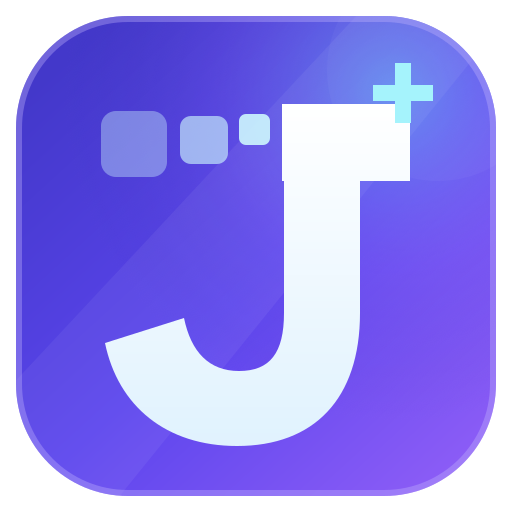

> **付费模型的正版许可证码只能通过 [Buy Me a Coffee](https://buymeacoffee.com/kruk2)、[Unifans](https://app.unifans.io/c/kruk2) 或 [闲鱼](#在闲鱼购买) 获取。**

[English](README.md) | [日本語](README.ja.md) | [**中文**](README.zh.md)

#  Jasna

Jasna 修复 视频和图像中的马赛克。它有简单的 GUI 和命令行，完全在 GPU 上运行
（NVIDIA，或实验性的 AMD）。

Jasna 是免费的。支持者会获得许可证码，用于激活为本项目训练的额外模型：
**unet-4x** 放大模型和实验性的 **SD 1.5** 图像模型（15 美元）；或者这两个再加上
**LTX** 修复模型（25 美元）。见[支持本项目](#支持本项目)。


## 目录

- [Jasna 能做什么](#jasna-能做什么)
- [社区](#社区)
- [要求](#要求)
- [快速开始](#快速开始)
- [首次运行](#首次运行)
- [了解更多](#了解更多)
- [基准测试](#基准测试)
- [许可证](#许可证)
- [支持本项目](#支持本项目)
- [致谢](#致谢)
- [TODO](#todo)

## Jasna 能做什么

- 修复视频中的马赛克，以及用 SD 1.5 模型修复图像中的马赛克。
- 用快速的 `rfdetr-v6` 模型查找马赛克。也有其他检测模型（更大的 RF-DETR、
  Lada YOLO、ZeLeFans）。
- 两个修复模型：快速的 **BasicVSR++**（默认，免费），以及慢但细节更多的
  [LTX](docs/zh/models.md#修复模型)（付费，仅限 NVIDIA）。
- 可选的[二次修复](docs/zh/models.md#二次修复)让修复区域更清晰，主要用于大马赛克
  和 4K（仅限 NVIDIA）：**unet-4x**、**RTX Super Resolution** 或 **Topaz Video AI**。
- 按每只眼处理 VR180 左右并排视频，并按片商选择设置。
- **区间编辑器**：只修复视频的一部分、扫描马赛克、预览结果，并为每个区间选择模型。
- 片段边界平滑过渡（时间重叠和交叉淡入淡出），不会跨镜头切换混合画面。
- **视频播放器**：实时观看修复后的视频，不用生成文件。
- 串流到浏览器，或串流到为 Jasna 制作的 [Stash](docs/zh/streaming.md#stash) 版本。

## 社区

加入 SLS Discord 查看示例、获取帮助和讨论设置。
请不要表现得太奇怪。

## 要求

- NVIDIA **GTX 16 系列 / RTX 20 系列或更新**。GTX 10 系列及更旧的显卡
  （GTX 1050/1060/1070/1080）无法使用。不确定？你的 GPU 在 NVIDIA 的
  [GPU 表格](https://developer.nvidia.com/cuda/gpus)中需要计算能力 7.5 或更高。
- NVIDIA 驱动：Windows 需 **610 或更新**，Linux 需 **580 或更新**。
- AMD（实验性）：ROCm 支持的 GPU（Radeon RX 7000/9000、Radeon 780M/760M/740M、
  Ryzen AI）。Windows 上需要 AMD Adrenalin 驱动 26.8.1 或更新。
- 把 Jasna 安装到路径只包含英文字母和数字的文件夹中，并放在本地磁盘上：
  Windows 用 NTFS，Linux 用 ext4、Btrfs 或 XFS。
- LTX 的要求更高。见 [LTX 需要什么](docs/zh/models.md#ltx-需要什么)。

## 快速开始

1. 下载适合你的系统和 GPU 的发行包。
2. 解压到路径只包含英文字母的文件夹。
3. 启动应用：
   - Windows：双击 `jasna.exe`。
   - Linux NVIDIA：运行 `jasna` 文件。
   - Linux AMD：运行 `run_jasna_amd.sh`。
4. 添加视频或图像，选择设置，点击开始。

首次启动需要更长时间。主窗口打开前，会先显示一个启动窗口，里面是安装检查。

在 Windows 上，Jasna 的临时文件也可以放在 ImDisk 等 NTFS 内存盘上。见
[Windows 临时文件](docs/zh/cli.md#windows-临时文件)。

每个设置都有提示：把鼠标移到 ⓘ 图标上即可查看。[GUI 指南](docs/zh/gui.md)
介绍了其余功能：队列、预设、输出文件名、视频播放器等。

命令行：

```bash
# One video
jasna --input input.mp4 --output output.mkv

# One image
jasna --input photo.png --output restored.png

# A whole folder
jasna --input input_folder --output output_folder
```

`jasna --help` 会列出所有选项。更多内容见 [CLI 参考](docs/zh/cli.md)。

## 首次运行

第一个任务会很慢，因为 Jasna 要为你的 GPU 准备文件。NVIDIA 上大约需要
**15–60 分钟**，AMD 上要短得多。这只会发生一次。这些文件保存在 `model_weights` 中，
之后会重复使用。你可以把它们从旧版本 Jasna 复制到新版本中。

在此期间请关闭其他应用（包括浏览器），也不要使用电脑。

任务中显存不足？先降低**最大片段大小**，例如从 `90` 降到 `60`。见
[调整 VRAM 和 GPU 占用](docs/zh/tuning.md)。

## 了解更多

- **[使用 GUI](docs/zh/gui.md)**：队列、预设、输出文件名、视频播放器、激活。
- **[选择模型](docs/zh/models.md)**：检测模型、BasicVSR++ 还是 LTX、二次修复、
  用于图像的 SD 1.5。
- **[只修复视频的一部分](docs/zh/segments.md)**：区间编辑器、马赛克扫描、
  仅大马赛克用 LTX、`--segments`。
- **[VR180 视频](docs/zh/vr180.md)**：如何处理左右并排 VR。
- **[调整 VRAM 和 GPU 占用](docs/zh/tuning.md)**：片段大小、时间重叠、显存不足时
  怎么办。
- **[高级处理](docs/zh/advanced_processing.md)**：降噪、60→30 FPS、色彩 LUT、
  锐化、编码器质量、队列完成后的操作。
- **[流媒体](docs/zh/streaming.md)**：在浏览器或 Stash 中观看。
- **[云 GPU](docs/zh/cloud.md)**：在租用的 GPU（RunPod、Vast）上运行 Jasna。
- **[CLI 参考](docs/zh/cli.md)**：所有命令行选项。
- **[从源代码运行](docs/en/development.md)**：面向开发者。

从源代码运行时可以使用免费的 BasicVSR++。激活和付费模型需要官方发行版。

## 基准测试

修复整个视频所需的时间，BasicVSR++ 加默认模型，RTX 5090（Linux），与 Lada 对比。
越低越好。测试片段长 3:22，8K VR 片段长 15 秒。

| 输入 | Lada 0.11.0 v2 | v0.4.1 | v0.5.0 | v0.9.0 (4a171c9) | **v0.9.1 (18add8a)** |
| --- | ---: | ---: | ---: | ---: | ---: |
| 720p H.264 8-bit | 01:47 (基准) | 01:35 (快 1.1 倍) | 00:45 (快 2.4 倍) | 00:34 (快 3.1 倍) | **00:32 (快 3.4 倍)** |
| 1080p H.264 8-bit | 02:02 (基准) | 01:46 (快 1.2 倍) | 00:47 (快 2.6 倍) | 00:39 (快 3.2 倍) | **00:34 (快 3.6 倍)** |
| 2160p H.264 8-bit | 04:56 (基准) | 03:23 (快 1.5 倍) | 01:22 (快 3.6 倍) | 01:15 (快 3.9 倍) | **01:03 (快 4.7 倍)** |
| 8K VR HEVC 8-bit 60 fps | — | — | — | 00:34 (8K 基准) | — |

GPU 显存占用（典型/峰值，单位 GB）。`—` 表示未测量。

| 输入 | Lada | v0.4.1 | v0.5.0 | v0.9.0 | **v0.9.1** |
| --- | ---: | ---: | ---: | ---: | ---: |
| 720p H.264 8-bit | 1.8/3.1 | 17.6/19.9 (基准) | 8.6/9.0 (少 2.0 倍) | 8.6/9.1 (少 2.0 倍) | **4.2/4.6 (少 4.2 倍)** |
| 1080p H.264 8-bit | 2.0/3.3 | 18.9/21.4 (基准) | 9.5/10.2 (少 2.0 倍) | 9.3/10.1 (少 2.0 倍) | **4.8/5.6 (少 3.9 倍)** |
| 2160p H.264 8-bit | 2.6/4.1 | 26.0/30.5 (基准) | 12.9/15.0 (少 2.0 倍) | 11.4/15.4 (少 2.3 倍) | **7.2/10.9 (少 3.6 倍)** |
| 8K VR HEVC 8-bit 60 fps | — | — | — | 17.1/18.3 (8K 基准) | — |

测试方法、内存占用以及所有版本和编码：
[完整基准测试报告](benchmarks/2026-07-26_release_matrix.md)。较早的完整长视频：
[旧版报告](benchmarks/2026-07-26_legacy_videos.md)。

## 许可证

Jasna 的公开应用程序源代码采用 AGPL-3.0。模型和捆绑依赖项保留各自的许可条款。
请参阅[许可与源代码范围](LICENSING.md)、
[模型声明](assets/THIRD_PARTY_MODELS.md)和
[发行版源代码对应表](RELEASE_SOURCES.md)。

## 支持本项目

你的支持用于训练新模型，主要是租用 GPU 来训练更大的数据集。付费模型：

| 支持 | 模型 |
| --- | --- |
| 累计 **15 美元**或以上 | **unet-4x**：二次放大模型，结果更清晰（256 → 1024）。<br>**SD 1.5**：用于静态图像的实验性模型。 |
| **25 美元** | **unet-4x** 和 **SD 1.5**，再加上<br>**LTX**：比 BasicVSR++ 慢很多，但细节更多。仅限 NVIDIA。包含这个 LTX 模型以后的更新。 |

**[TBD] 之前**累计支持 **15 美元或以上**的支持者可免费获得 LTX。

**购买 LTX 之前：**

- 看看 SLS Discord 频道
  中的示例。
- 在你的电脑上用**试用模式（速度测试）**运行 LTX。它是免费的，可以看出你的 GPU 能否
  运行 LTX、需要多长时间。视频不会被修复。见
  [LTX 需要什么](docs/zh/models.md#ltx-需要什么)。

更多示例：

- unet-4x / 二次修复（SLS Discord）
- SD 1.5 图像修复（SLS Discord） 和 更多 SD 1.5 示例

### 在哪里购买

许可证码**只**在这里出售：

- [Buy Me a Coffee](https://buymeacoffee.com/kruk2)（也可以用加密货币）
- [Unifans](https://app.unifans.io/c/kruk2)
- 中国用户：[闲鱼 (Xianyu)](#在闲鱼购买)，见下文

#### 在闲鱼购买

国内用户可以直接在闲鱼购买，得到的许可证码和其他渠道一样。闲鱼使用单独的人民币本地价格，以商品页面为准。

1. 用闲鱼 App 扫描下面的二维码，或打开[这个链接](XIANYU_LINK_TBD)。
   商品名称是 **jasna正版激活码**。
2. 下单后，卖家会发给你**许可证码**。
3. 按照下面的[如何激活](#如何激活)在 Jasna 中激活。


只有这个闲鱼商品是官方的。闲鱼上其他卖 Jasna 的人都不是官方卖家。

其他出售 Jasna、许可证码或修改版文件的人都是骗子：他们的密钥无法使用，他们的文件
可能在你的电脑上运行隐藏代码。请只从 GitHub 下载 Jasna。

### 如何激活

1. 在上面的任一页面购买。你会收到一个**许可证码**。
2. 在 Jasna 中打开**激活 Jasna**，输入许可证码，点击**在线激活**。
3. 这台电脑没有网络，或激活失败？选择**手动**，见
   [激活付费模型](docs/zh/gui.md#激活付费模型)。

一个许可证码可用于 **3 台电脑或云工作区**。之后会离线检查激活。租用的 GPU：见
[云 GPU](docs/zh/cloud.md)。

## 致谢

- **Lada（Codeberg）**：Jasna 受 Lada 启发，
  部分地方也基于 Lada。Jasna 使用的 `mosaic_restoration_1.2` 模型由 Lada 作者
  ladaapp 训练。
- **ZeLeFans**：感谢提供 VR 检测模型，以及对马赛克形状和 VR 投影的详细分析。

## TODO

当前 TODO：

- SeedVR 支持？
- 持续改善性能和 VRAM 使用。
- 更好的修复模型。
- 更好的检测模型。
